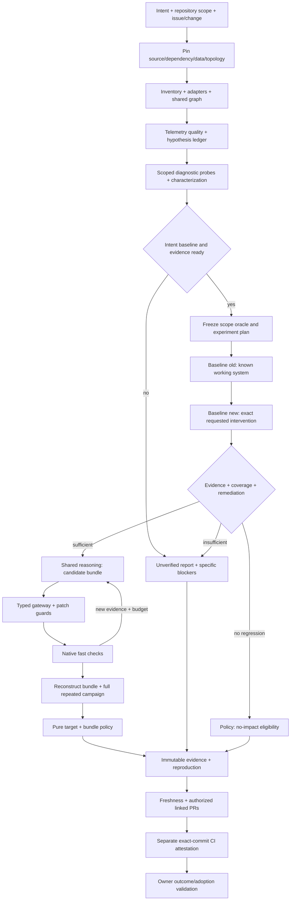
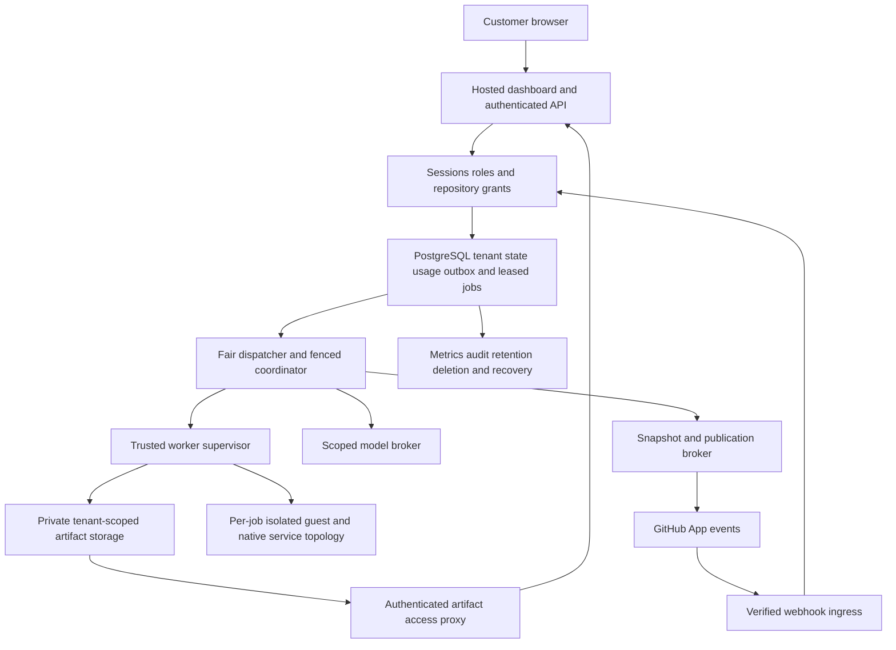

# ChangeProof AI 1.0 — Hosted SaaS Modular Monolith Architecture

**Active scope:** all features/modules mentioned in these four documents and `mockup.html` are mandatory in the complete release. No features are deferred to a later phase; implementation order follows dependencies. Design targets and mockup displays remain non-proof of implementation. Legacy scope decisions in the history of MVP §19 have been superseded.

**Status:** initial design for 1.0 implementation; the following structure is a target.  
**Reference:** [BRD](BRD.md), [PRD](PRD.md), [MVP](MVP.md).

**Target depth:** [problem classes](PRD.md#17-problem-profiles-and-capability-limits) and [acceptance protocol](MVP.md#17-campaign-protocol-and-acceptance-dossier). The addition of observability/campaign/measurement below does not yet state that implementation or qualification is available.

## 1. Key Decisions

Build a TypeScript hosted SaaS with a modular monolith architecture. A single application package/release, a shared reasoning engine, a single change representation, a deterministic policy, and ecosystem-specific adapters serve as its foundation. Web/API, dispatcher, and worker supervisor are process roles from the same codebase; replica counts can vary without a release per leaf module. Product source is directed open source, customer onboarding via browser/GitHub App without cloning or running their own server.

The product handles cross-language/framework/repository changes, dependency upgrades, database migrations, event/cache compatibility, and adaptive recovery. Minimum capability and real-outcome gates are established in the MVP. The TypeScript host does not restrict the application languages analyzed or executed.

Source modules reside in a single release artifact with separated deployment roles. Native compilers, language tools, application processes, databases, message brokers, and protected verification run in a disposable runtime topology inside a qualified guest VM/microVM per job or equivalent boundary. The host/control-plane does not execute consumer source. Public hosted execution awaits hostile-code isolation qualification, not just container probes. Delivery details are in [hosted SaaS](PRD.md#18-customer-journey-and-hosted-access).

## 2. Target Structure

```text
changeproof/
├── package.json
├── pnpm-lock.yaml
├── tsconfig.json
├── vitest.config.ts
├── eslint.config.mjs
├── .dependency-cruiser.cjs
├── src/
│   ├── core/
│   │   ├── contracts/          # Versioned Zod schemas, ports, identities
│   │   ├── errors/             # Typed failures and reason codes
│   │   └── index.ts
│   ├── modules/
│   │   ├── identity/          # Sessions, organizations, roles, and grants
│   │   ├── jobs/              # Durable queue, leases/fencing, outbox, and admission
│   │   ├── usage/             # Entitlements, reservations, ledger, and settlement
│   │   ├── lifecycle/         # Retention, deletion/tombstones, and audit
│   │   ├── notifications/     # Durable per-user inbox, preferences, delivery receipts
│   │   ├── queries/           # Authorized search/filter/read projections and export plans
│   │   ├── support/           # Tickets, opaque access requests, and scoped support grants
│   │   ├── collaboration/     # Internal/reviewer threads, revisions, and audience
│   │   ├── adapters/
│   │   │   ├── registry/
│   │   │   ├── typescript/     # JS/TS frameworks + schema/persistence adapters
│   │   │   ├── python/
│   │   │   ├── jvm/            # Java/Kotlin
│   │   │   ├── go/
│   │   │   ├── php/
│   │   │   └── dotnet/
│   │   ├── detector/          # API/dependency/data/event changes
│   │   ├── analyzer/          # Structural analysis and impact attribution
│   │   ├── graph/             # Versioned system graph + traversal
│   │   ├── observability/     # Read-only telemetry normalization and quality facts
│   │   ├── migrations/        # Data/rollout plans and consistency facts
│   │   ├── dependencies/      # Trusted resolution/acquisition broker
│   │   ├── fixtures/          # Trusted real-app/oracle authoring, freeze/export
│   │   ├── agent/             # Shared model client, reasoning, bounded tools
│   │   ├── verifier/          # Native stages, supervisor, isolation, observations
│   │   ├── policy/            # Pure target + bundle decisions
│   │   ├── evidence/          # Canonical artifacts, storage, rendering
│   │   ├── github/            # GitHub App adapter and CI attestations
│   │   └── repositories/      # Provider-neutral ports + GitLab/Bitbucket adapters
│   ├── orchestrator/          # Composition, scope, budgets, lifecycle/recovery
│   ├── http/                  # Authenticated API/webhooks/event streams
│   ├── workers/               # Dispatcher/supervisor entrypoints
│   └── cli/                   # Operator/developer interface
├── config/                    # Capabilities, check maps, topology/budget profiles
├── fixtures/                  # Controlled runnable applications + authoring inputs
├── tests/                     # Integration, boundary, security, real-system tests
├── bench/                     # Versioned evaluation manifests/harness
├── apps/dashboard/            # Hosted UI; compiled into same application release
├── apps/trace-viewer/          # Protected read-only evidence UI, reused in dashboard
├── infra/                     # Deployment profiles, DB migrations, and recovery plans
├── docs/                      # Decisions, reports, reproduction
└── runs/                      # Disposable artifacts, excluded from Git
```

Each module has a public `index.ts`. There are no separate internal packages or releases per module. Fixture/pilot applications and native adapter helper tools can have language-appropriate manifests/lockfiles; all are inputs/artifacts separate from the host package and are not executed with host authority.

Protected oracles are exported outside the candidate workspace, frozen before the run, and mounted only on the verifier. The authoring location in the repository is not the same as runtime access.

## 3. Ownership and Import Matrix

| Component | Ownership | Internal imports |
| --- | --- | --- |
| `core` | Schemas/ports/IDs and contracts without application orchestration | None |
| `adapters` | Detection/extraction/framework transformations/check plans | `core`; shared helpers within adapter boundaries |
| `detector` | Change and hypothesis normalization | `core` |
| `analyzer` | Impacts, provenance, unresolved signals | `core` |
| `graph` | Nodes/edges, traversal, affected subgraph | `core` |
| `migrations` | Migration/compatibility planning facts | `core` |
| `dependencies` | Allowlisted package resolution, artifact integrity | `core` |
| `fixtures` | Trusted oracle/dataset authoring and freeze | `core` |
| `agent` | Model broker, hypothesis ledger, candidate proposal | `core` |
| `observability` | Read-only ingestion, identity/time correlation, sampling/clock/provenance facts | `core` |
| `verifier` | Trusted supervisor, native execution, schedules/faults, repeated campaigns, and measurement reducers | `core` |
| `policy` | Pure guard/proof/coverage/target/bundle rules | `core` |
| `evidence` | Manifest, immutable store, deterministic renderer | `core` |
| `github` | Snapshots, validated PR publication, and CI metadata | `core` |
| `identity` | Session/email/GitHub/SAML/SCIM, organization, role, and repository grant validation | `core` |
| `notifications` | Durable inbox/read/preferences/dedup, and typed delivery | `core` |
| `queries` | Authorized list/search/projection/cursor/export planning | `core` |
| `support` | Tickets/access requests/incident views, and expiring support access | `core` |
| `collaboration` | Candidate-bound comments/audience/history/outdated | `core` |
| `repositories` | Provider adapters, exact snapshots/events/publication receipts | `core` |
| `jobs` | Durable admission/outbox, fair scheduling, leases/fencing | `core` |
| `usage` | Atomic reservations, measured usage, caps, and settlement | `core` |
| `lifecycle` | Retention, deletion fences/tombstones, audit | `core` |
| `orchestrator` | Composition root, scope, repair-set lifecycle | Public APIs of all modules |
| `http` | Authenticated API, CSRF/request validation, webhook/event transport | `core`, `orchestrator` |
| `workers` | Authenticated dispatcher/supervisor composition entrypoints | `core`, `orchestrator` |
| `dashboard` | Customer browser UI, no credentials/database/model authority | Browser-safe `core` contracts, authenticated HTTP API |
| `cli` | Args/config validation and pipeline invocation | `core`, `orchestrator` |
| `trace-viewer` | Read-only evidence audit | Browser-safe contracts from `core` |
| `bench` | Independent evaluation wiring | Required public APIs |

Cross-module services are supplied through ports in core; leaf modules do not import implementations from each other. Orchestrator wires analyzer with adapters, agent with guarded gateway, and verifier with native check plans. Policy does not import I/O/models, does not read clock/environment, and has no divergent rules per framework.

Hosted authorization, grant revocation, and quotas represent admission/side-effect authority, separate from proof policy. Scopes/grants/leases are carried through typed ports; the broker validates authority when executing effects, not merely during HTTP requests. Shared persistence transaction/outbox ports enable atomic reservation+job+receipt without jobs importing usage/identity implementations. The browser does not import orchestrator or server-only schemas containing secrets.

Observability yields facts and quality gaps, not verdicts or causal truth. The hypothesis ledger resides in the agent/planning service; controlled experiments are executed by the verifier, and results are validated by the coordinator. Pure policy receives precomputed dimension facts alongside validity/config identities. Telemetry correlation, causal hypotheses, and independent proof have distinct ownership.

Dependency-cruiser and linter reject cycles, unresolved imports, deep imports, forbidden built-ins, and re-export/transitive escapes. Test boundaries with prohibited import test cases. Source rules complement isolation tests; they do not replace them.

## 4. Framework Adapter System

Adapters possess `detect`, `extract`, `analyze`, `planFix`, `applyPatch`, and `verify` in accordance with FR3-02. `planFix` supplies constraints/options to the shared planner; `applyPatch` utilizes the trusted gateway; `verify` describes the check plan executed by the independent verifier.

The adapter registry maps ecosystem/framework/version/feature/change class to a capability record. Separate target level from proven level. Initial records are uncertified; L1/L2/L3 require conformance and real evidence according to the MVP.

Use AST, language server, compiler metadata, or structural parsers appropriate to the language. Native helpers run as bounded workers with input/output schemas. The model may interpret ambiguity, but must not convert inferred edges to proven without evidence. Unresolved dynamic/reflection/DI remains visible.

Adapters are not plugins retrieved from untrusted repositories. Adapter sources and native helpers must be reviewed, versioned, and registered in trusted configuration. Executed framework packages/dependencies are still treated as untrusted code.

## 5. Shared Data Model

Readiness/efficiency depth adds contracts and target versions in [PRD §20](PRD.md#product-depth-decision); ownership and data flow in [§20](#product-depth-architecture). Contract plan/approval/cache is not verdict authority.

Central to the pipeline are `ChangeIntent`, `InterventionManifest`, `ProjectInventory`, `CapabilityRecord`, `SystemGraph`, `VerificationPlan`, `RepairPlan`, `CandidateBundle`, `StageResult`, and target/bundle assessments. Complete field requirements reside in PRD §8.

Add `IncidentEvidence`, `HypothesisRecord`, `ExperimentPlan`, `TrialReceipt`, `DimensionAssessment`, and `CharacterizationRecord` per FR3-25..28. Plans bind subjects, workload, fault/schedule, n, reset/data, measurements, thresholds, budgets, and claim envelope. Trial receipts cannot be transferred across plans or candidate revisions.

The graph encompasses source symbols, APIs/DTOs, dependency artifacts, DB schemas, events, caches, business workflows, and deployment prerequisites. Each edge carries provenance/snapshot and proven/inferred/unresolved status. The candidate bundle hash binds all members, including unpatched targets that remain required for integration proof.

Do not pass AST objects or arbitrary runtime handles as cross-module contracts. The analyzer may have a local cache; persisted graphs/observations consist of validated data. Raw byte hashes and canonical structured identities are distinguished.

## 6. Pipeline and Repair Lifecycle



Probes do not require candidate write permissions: default to read-only telemetry or trusted experiments on disposable clones. Autonomous mutation still requires a valid baseline/oracle. Legacy code without a known-valid state stops at diagnosis/characterization; proposed business intent is not frozen by the fixer itself.

All error/skip/stale/cancel paths preserve available evidence. Detection may perform a workflow skip only if the entire relevant change scope is proven non-breaking; non-breaking OpenAPI alone must not conceal breaking DB/event/dependency changes.

Baseline old/new uses an exact intervention manifest to bound intentional deltas. Regressions from unrelated environment drift are not considered attributed. New intent and preserved invariants are frozen before proposals. The agent must not resolve issues by reverting intended changes.

Full verification encompasses native target checks and actual cross-system/data/event/browser behavior. Target pass does not automatically equal bundle pass. The final plan includes mandatory intermediate rollout states; multi-repo publication is not equivalent to atomic deployment.

Full verification is a campaign for intermittent classes, not a single command pass. Retain invocation/return/commit history, actual fault/schedule receipts, every-trial results, and C/P/R/D facts. Pinned seeds do not control kernel/GC/JIT/DB/network ordering; reproduction mode states controlled, observed-partial, or uncontrolled scheduling along with claim bounds.

## 7. Trust Boundaries and Actual Services

| Area | Access | Restrictions |
| --- | --- | --- |
| Trusted coordinator | Pinned config, scope, state, adapters, and policy | Does not execute consumer source directly |
| Model broker | Model credentials + permitted context | Does not forward credentials to tests/tools |
| Observability connector | Scoped read-only logs/traces/metrics/deploy exports | Redaction, retention, clock/sampling gaps; no write/deploy authority |
| Candidate gateway | Allowlisted source paths and typed mutations | No oracle, privileged config, or arbitrary shell |
| Dependency broker/build sandbox | Allowlisted registries/artifacts | Integrity/provenance, bounded acquisition; install scripts remain isolated |
| Verifier supervisor | Creates topology/containers, mounts oracle, collects observations | Control authority is not granted to candidate/test code |
| Application/test containers | Native runtime + ephemeral service credentials | Non-root, caps, no host socket/secrets, private per-run network |
| PostgreSQL/Redis/services | Disposable data and service-to-service communication | No internet/host/other-run access, separate namespace and lifecycle |
| GitHub broker | Minimal token + validated publication request | Does not run consumer source |
| Evidence/viewer | Immutable/redacted artifacts | Read-only UI, escapes untrusted logs |

A private topology is required for real integration. Default egress is closed; allowlisted internal connections can be opened by the supervisor. Do not interpret network isolation as a prohibition of all inter-service traffic. Runtime DB credentials are ephemeral for disposable data, not production secrets.

Native test frameworks wishing to spin up containers do not receive the host Docker socket. The supervisor can pre-provision services through trusted plans; alternative infrastructure boundaries must prove equivalent isolation.

Fault injection resides in the supervisor: only target processes/edges designated by the frozen plan, private topology, finite duration, heal/cleanup receipts. The model proposes typed probe intent; the coordinator selects/validates trusted plan IDs. The model does not acquire raw network-control/process-kill APIs or the ability to alter acceptance oracles/schedules. Captured telemetry and logs remain untrusted data.

## 8. Mutation Capabilities

Source repair is restricted by a path/operation allowlist. Guards protect policy, verifier, oracle, security controls, unrelated files, and script execution authority.

Dependency upgrades that represent explicit intent can alter manifests and generate lockfiles via a trusted resolver. Data migrations can add migrations/backfills bounded in scope and verified. Relevant application configuration can be patched via specific capabilities. There is no global exception allowing the model to modify package scripts, validators, or checks in order to pass.

Rollout/data execution in production is a separate operation. Disposable rehearsal is the default verification. Destructive/non-reversible operations require recovery proof and actual scope permission before application to user data.

## 9. Policy and Evidence Authority

Target outcomes use the vocabulary `fixed`, `no_impact_verified`, `unverified`, `partial`, `failed`, with explicit subjects and policy/schema versions. Stale/cancelled run states and workflow skips remain separate.

Bundle assessment `verified | incomplete | blocked | invalid` binds required targets, edges, invariant set, intent, data/topology, freshness, and rollout combinations. Policy does not use pass averages, model confidence, or summary text as proof.

Negative checks, full pass with blocking unknowns, invalid oracles, mixed candidate identities, and budget exhaustion must be tested first. Evidence/reproduction/publishing always references the exact candidate tested; candidate revisions require fresh proof on the affected scope.

`DimensionAssessment` evaluates correctness, performance, resilience, and data integrity separately. Deterministic statistical reducers use algorithm/config digests and raw observations; policy does not compute status from model narrative. An inconclusive required dimension halts assurance; invalid receipts supersede local passes. Planned product timeouts during partitions are distinguished from verifier timeouts/injector failures. Precedence references reside in FR3-16.

The no-progress stopper compares hypothesis/candidate/failure signatures alongside new evidence, rather than token counts or patch lines. Two non-informative attempts terminate the branch; a new investigation proceeds only with distinguishing probes and remaining budget. Stop records encompass unknowns, missing access/evidence, and the next safe action.

## 10. State and Resource Profiles

The hosted MVP uses PostgreSQL as the single authoritative state source for tenants/grants, run/bundle/target/attempt/check IDs, identities, budgets/reservations/usage, job leases, checkpoints, outbox, audit, and publication records. Private object storage stores immutable content-addressed artifacts for the duration of retention. JSON serves as manifests/exports for reproduction, not local authority across replicas. DB migrations, transaction boundaries, compare-and-swap versions, tenant-scoped constraints, and outbox delivery are tested; customer applications' disposable Redis is not a hosted state store.

Resume validates identities and continues with the same budget. Profiles have finite limits per target and bundle as well as reserves for full/evidence. Values are selected through development calibration and frozen prior to acceptance; missing limits constitute configuration errors. Profiles for distinct workloads have their own identity/version.

The campaign scheduler stores planned/completed/failed/invalid/censored/not_run counts, trial seed/schedule position, data-reset identity, and fault lifecycle. Resuming an interrupted trial is not considered a pass; new trials receive a new receipt with cumulative resource usage. Concurrent trial isolation must be proven so that shared host/DB/noise does not alter results; performance defaults use isolated matched blocks.

Hosted job leases feature a monotonic fencing epoch; writes/checkpoints/publications from a stale epoch are rejected. Stable effect identity, unique receipts, and reconciliation handle at-least-once retries. Per-tenant/global concurrency and queue limits constrain admission; quota reservations are made in transactions alongside run/outbox. Current repo grants and disconnect/deletion fences are re-checked by brokers. Audit and usage IDs do not constitute access permissions. Cross-tenant cached sources/dependencies are not shared at minimum; trusted public images may be shared.

Aggregate forecasts encompass source builds, independent resets, journal/storage, trace retention, n trials, warmup, observation/cooldown, full reproduction, and cleanup. Proposal budgets are not multiplied through child experiments. If the current runtime cap cannot accommodate mandatory proof, the system raises a resource blocker, rather than lowering n/thresholds after initiation.

Timeout/cancel terminates the entire process/service topology and cleans up networks/volumes/ephemeral credentials. Retain required logs/receipts prior to cleanup. Cleanup failures are reported and block environment reuse.

## 11. Development and Distribution

Dashboard/API and hosted deployment represent primary delivery; the CLI is operator/developer tooling. Source releases require licensing/third-party notices and build revision mapping; license choice is not yet determined. Customer source/evidence remains private. Self-host installation/upgrade/restore, BYOK, and multi-cloud deployment profiles are mandatory alongside hosted gates. The browser build is included in a single application release; no package/release per module is required.

Host: TypeScript strict, pnpm, Zod, Vitest, ESLint, dependency-cruiser. Use ts-morph for TS, oasdiff for OpenAPI, Octokit for GitHub according to capability. Native tools for other languages are selected/version-pinned per adapter; interfaces remain language-neutral.

Development runners, tests, compiler resolution, and CLI output must remain consistent. TypeScript aliases do not themselves rewrite emitted imports. A single host package simplifies wiring; install/build/test performance remains measured. A standalone operator binary is mandatory as an additional distribution form, with native tools/services still managed according to qualified profiles.

Target scripts: build, typecheck, lint, unit/integration, adapter conformance, security/native runner, real-system E2E, certification, dev evaluation, frozen holdout, and reproduction. New names/scripts are claimed available only after being genuinely implemented.

Unit mocks/replay aid development. Certification/complex repair/pilot acceptance adheres to MVP actual execution requirements, without silent simulation fallbacks. All performance numbers derive from actual workloads, not architectural assumptions.

## 12. Execution Order

The seven playbooks [phase-1](phases/phase-1.md) through [phase-7](phases/phase-7.md) group back-end development (1–5), product front-end from the final mockup ([phase-6](phases/phase-6.md)), and whole-system testing/qualification (7) over the same full-WP DAG according to [MVP §22](MVP.md#execution-phases). The `phases/` directory contains engineering instructions, not executable product modules. Implementation remains at target locations at the project root. Reports in `docs/phase-reports/phase-N.md` store engineering progress and artifact refs, not replacing PostgreSQL as authoritative product state or immutable evidence manifests.

Use the MVP dependency graph for all of WP3-01..34: engine, complex qualification, hosted, public UX, collaboration, enterprise/distribution, and full catalog are all mandatory. Hosted identity/persistence begins after WP3-02, followed by GitHub grants, isolated durable jobs, usage/caps, dashboard integration, and operations qualification. Final acceptance of WP3-14 depends on WP3-12/13/19/20/26/31/32/33/34; public/auth/notification/search/support/collaboration enters ancestors through WP3-25/26. Engine-only/CLI-only does not pass the complete release.

WP3-19 (multi-region/long-horizon) and WP3-20 (qualified legacy recovery) are mandatory release prerequisites. ID numbers do not dictate order; the graph in the MVP governs dependencies. There is no separate concurrency/distributed/performance AI module: native adapters, shared graph, and shared verifier campaigns are reused.

Order follows dependencies; there is no calendar schedule. Agents create task reports with BR3/FR3 IDs, acceptance proof, commands/exit codes, missing checks, and next ready tasks. A capability is considered complete when observable behavior and evidence are proven. Execution-plan revision 2 splits service/UI/acceptance tasks without changing module ownership, import boundaries or full-WP prerequisites. Backend phases implement core/modules/orchestrator/http/workers/cli/infra/tooling; product apps/dashboard and apps/trace-viewer UI is phase-6. Native browser/customer fixtures remain required for backend engine proof. Independent preparation may use proven versioned task inputs while full dependencies are open, but cannot close a WP or bypass UI/whole-system acceptance. Local tests run in every development phase; phase-7 performs full catalog campaigns and final gate review. Specification paths resolve from this document directory, conventionally `` or the extracted project root.

## 13. Contract and Documentation Consistency

BRD, PRD, MVP, and the architecture in this folder form a single initial briefing. The PRD establishes policy, adapter/data contracts, topology, and mutation capabilities; the MVP establishes the support matrix, resource calibration, evaluation, and release gates. Implementation does not depend on planning documents outside this package.

Schemas and policies have explicit versions from the beginning. Changes to semantics, oracles, budgets, or proof scopes are recorded in technical decisions along with impacted tests and evidence. Results on one stack do not prove support for another stack. MVP success is determined by all actual gates, including benefit on organic pilots.

## 14. Additional Boundary Test Obligations

| Boundary | Failure to be tested |
| --- | --- |
| Telemetry → graph/ledger | Clock skew/stale deploy/unknown spans do not become fabricated causal edges |
| Planner → experiment supervisor | Raw shell/network targets, out-of-scope kill, oracle/schedule mutation rejected |
| Trial → reducer | Missing/duplicate histories, wrong candidates, injector noops, invalid resets, cherry-picked windows rejected |
| Reducer → policy | Functional pass + perf inconclusive; target pass + convergence fail; known intermittent + unknown harness quality |
| State → resume | Cap does not reset; partial trials not treated as passes; invalidated candidates do not reuse receipts |
| Legacy characterization → fixer | Self-derived oracles lacking owner/domain evidence halt autonomous mutation |

These obligations are implementation acceptance targets; only document checks were executed during the specification drafting task.

## 15. Hosted Topology and Trust Boundaries



Network/database/storage permissions are separated per process role. The coordinator holds required DB/queue scopes; guests have no connection to the hosted DB, secret manager, or global artifact buckets. The supervisor transmits receipts over scoped authenticated channels. The model broker holds operator credentials with least-context requests and configured cost ceilings; provider availability/data-policy verification is a preflight blocker. The GitHub broker acquires fresh installation authority; no tokens are mounted into guests. Model/API/GitHub network access resides solely on brokers, not unrestricted candidate egress.

Tenant isolation encompasses account/project/repository grants, DB rows, object references, search/index, event subscriptions, logs, cache keys, and support access. Every access proxy request validates current authorization; an opaque URL is not sufficient. Artifact source refs can be multi-repo, requiring authorization across all relevant grants. PostgreSQL RLS defense and pooling context reset are tested with concurrent tenants; migration/service roles are not used for customer queries.

Revocation epochs and deletion fences abort new admissions/effects, cancel queued/active work, and halt publication. In-flight external effects are reconciled without promises of atomic rollback. Restores execute deletion tombstones prior to serving public traffic; backup retention does not cause deleted data to abruptly reappear. Immutable manifests are not overwritten; expiry/deletion yields an honest unavailable status and halts publication requiring missing evidence.

## 16. Hosted Service Operations

Operators manage signed/versioned images, secret rotation, domain/TLS, migrations, private storage, backup/restore, worker drain/quarantine, and incident response. Health/readiness/liveness is distinguished from proof success. Capacity admission factors in CPU/RAM/disk/guest availability, provider quotas, and per-tenant fairness; not merely web process counts. A single modular monolith can have numerous process replicas without decomposing the engine into microservices.

HostedServiceProfile defines finite numeric SLOs/capacities, queue wait/fairness, cost overshoots, RPO/RTO, and data retention/deletion. Freeze profiles prior to load/failover/backup acceptance; missing values block G3-14. Staged deployments/rollbacks evaluate host old/new schema/job compatibility; no orphan leases/duplicate charges/PRs. An application rollback does not automatically roll back a destructive DB migration.

Bounded public release adheres to supported repositories/profiles and measured limits. Provider outages produce explicit service/job statuses, not simulated success. Paid plans and free capped services are both mandatory: payment qualification, metering, and spending caps must pass prior to complete release. Runbook/source manifests are deliverables prior to public launch; all statuses remain targets until actual receipts are available.


## 17. Hosted Security and Data Operations Details

### 5. Queue, Execution, and Customer Isolation

The API does not run customer code in web processes. A single modular codebase/release yields process roles for web/API, coordinator/dispatcher, and trusted worker supervisor. PostgreSQL is authoritative for tenants, grants, run state, queue/leases, audit, and usage. A transactional outbox couples requests, reservations, and enqueueing; private object storage stores artifacts. Local JSON is not used as a hosted source of truth.

The at-least-once queue utilizes durable job IDs, bounded retries, leases/heartbeats, fencing tokens, and unique constraints for effect idempotency. Jobs that lose their lease cannot write checkpoints/final results or publish; brokers verify fencing epochs and grant versions. Resuming binds the exact same snapshot, plan, budget, and receipt. State transitions use compare-and-swap/version checks. External publication relies on stable idempotency identity and reconciliation when responses are lost, not network exactly-once claims.

Fair scheduling applies per-tenant concurrency/admission limits, global capacity, and starvation checks. Worker draining does not accept new jobs; crash recovery cleans up orphans then requeues only if safe. Job payloads contain opaque IDs/validated hashes and secret references; workers pull current scoped authority from the coordinator. The queue is not trusted as permanent permission.

Hosted execution of customer source constitutes untrusted-code execution. The minimum sandbox requires a VM/microVM boundary per job or an alternative demonstrating equivalent isolation; non-root containers alone are insufficient evidence of public hosted readiness. Native service containers can run within that boundary. Guests possess no host sockets/cloud metadata/control-plane network, shared secrets, persistent tenant volumes, or supervisor privileges. Default egress is closed; the dependency broker executes permitted acquisitions. Provider model and GitHub calls originate from brokers, not guests.

Worker capacity health, quarantine, patched runner images, disk/log/CPU/memory limits, and per-run cleanup must be tested. Cross-tenant reuse of guests/volumes/caches is rejected at minimum; trusted signed toolchain/base images may be shared. Private dependency/source caches are namespaced per tenant with grant/retention checks. Suspected sandbox escapes quarantine the worker and halt associated admission. Unqualified boundaries restrict the service to allowlisted pilots; public signups do not automatically authorize arbitrary repository execution.


### 7. Data, Evidence, and Open Source

Customer source, issues, traces, prompts, responses, artifacts, and audit metadata map to tenants, repository grants, and retention policies. Transport/storage encryption as well as key rotation/restore are tested. Customers see data categories transmitted to models/providers, retention, selected region/storage locations, and subprocessors. Do not promise zero retention/no training unproven by provider configuration and terms; missing policies block hosted launch.

Source/data is not used for training or cross-tenant retrieval by ChangeProof by default; changes in use require a separate, recorded opt-in. Raw customer code/logs do not enter platform analytics, public issues, or error monitoring. Redaction is tested against fixtures containing secrets; required evidence preserves provenance and original hashes in permitted storage, rather than leaking originals to all reviewers.

Artifacts are private-by-default. Opaque IDs, tenant paths, and signed URLs alone do not constitute authorization. Downloads pass through an authenticated proxy checking current grants; public caching/CDNs are disabled. Where CI access is required, use narrowly scoped revocable service grants. GitHub reviewers lacking hosted rights receive access requests without artifact leakage. The product open-source license does not open customer source or evidence.

Immutable evidence signifies content-addressed/non-overwritten status during retention, not permanent indestructibility. Owners can request deletion with job fencing, execution cleanup, blob/index/cache purging, and receipts. Backup expiry is bounded and disclosed; restores execute deletion tombstones prior to serving traffic. Minimal audit logs retained follow documented purposes/periods and omit source/secrets. Retention durations, backup windows, and deletion completion SLOs must be finite prior to release; purge failures are reported, not falsely marked complete.

ChangeProof source, deployment manifests, versioned APIs/contracts, and documentation must have a release source matchable to the hosted build. Open-source licenses and third-party notices are established prior to public source distribution; this document does not claim a license already exists or choose one silently. Contributors can clone the source. Hosted end users need not clone. Self-hosting must be available using the identical engine, with installation/upgrade/restore qualification alongside hosted release gates. There is no requirement to open-source customer repositories.


### 8. Operations and Public Release

Operators manage TLS/domains, secrets, DB migrations, object storage, execution fleets, alerting, backup/restore, and incident response. Deployment/runbooks, infrastructure configurations, and image digests are reproduced from a clean environment. GitHub/model callbacks, signed releases, and key rotations have designated owners. DB migrations employ expand/contract when old/new host roles overlap; application rollbacks are not assumed to revert data migrations.

`HostedServiceProfile` must freeze numeric capacity/SLOs prior to acceptance: active tenants/users, API/event-stream load, admitted/queued/running jobs, API latency/errors, queue wait, completion accounting, per-tenant fairness window, saturation behavior, failover time, RPO/RTO, backup/retention/purge horizon, dependency quotas, and total cost. Values are selected via capacity calibration; there are no promises of unlimited capacity or fabricated uptime.

Minimum `[DERIVED]` qualification involves at least three independent customer organizations and two identities per organization, with allowed and denied private repository scopes. This constitutes the baseline isolation/onboarding proof floor, not an internet-scale claim. Load campaigns are frozen against tier capacity to be offered; wrong-tenant disclosure and duplicate usage/PRs are disallowed. Hostile security fixtures remain separate from customer organic issues.

Required drills: concurrent signup/invite/run, forged tenant/repo/artifact IDs, revoked access while queued/running/publishing/downloading, duplicate/out-of-order webhooks, lost worker leases, queue/DB/object-store/model outages, backup restore with deletion replay, noisy neighbor, and sandbox escape probes. Browser-to-live-run-to-PR acceptance and independent customers must use the real deployed hosted stack, actual model/native execution, and authorized GitHub repositories. Local demo/mock dashboards do not pass hosted gates.

Following passage of all gates, public access remains bounded by supported scopes, explicit limits, and measured capacity. Multi-user readiness is a property of the ChangeProof service, distinct from concurrency certification on customer applications. The hosted SaaS product does not automatically authorize production deployments on customer applications.


## 18. Interface Font Assets and Attribution

- **Inter** (400–800): body, forms, tables, and interface labels.
- **Plus Jakarta Sans** (500–800): headings and wordmarks in the HTML interface.

Both fonts use the SIL Open Font License 1.1. The original copyright/license files
and original WOFF2 assets are embedded in `mockup.html` in the `changeproof-source-assets` JSON block; stylesheet font data remains embedded.
Source: [Inter](https://github.com/google/fonts/tree/main/ofl/inter) and
[Plus Jakarta Sans](https://github.com/google/fonts/tree/main/ofl/plusjakartasans).

The Latin variable WOFF2 files were retrieved through the official Google Fonts
CSS service. The standalone HTML retains their embedded data URLs.
The current `mockup.html` embeds these fonts without any external request.


## 19. Modules and Boundaries for All Key Features

All features in [PRD §19](PRD.md#19-complete-product-features-mockups-and-scope) are mandatory and included in a single application release. Folders/modules represent target designs, not claims that source is already available. `notifications`, `queries`, `support`, `collaboration`, and provider-neutral `repositories` add service ownership; shared reasoning, graph, verifier, policy, and evidence remain unified. `github` provides the GitHub adapter; GitLab/Bitbucket use the same contracts with provider-specific validation. Leaf modules import only `core`; orchestrator supplies typed ports/transactions and validated authority.

### Identity, Public Site, and Browser Shell

`identity` owns password/provider account bindings, challenges/sessions, email verification/reset, SAML/SCIM, and org/project grants. Email delivery passes through a trusted port/broker with encrypted secret refs, purpose-bound single-use tokens, and durable retry receipts. SCIM/SAML mapping does not confer repository or platform operator permissions. `http` provides routes for public content/identity, authenticated tenant API, and privileged operator API with separated middleware/roles. Public content contains no tenant projections; sample reports use a separate static dataset. Customer Owners cannot open operator queue/worker mutations simply by virtue of owning an organization.

`apps/dashboard` provides public pages, identity/onboarding, workspaces, operator surfaces, and shared UI shell within the same build. The browser receives safe contracts and authenticated projections, not DB/model credentials or authority modules. Login return targets are validated server-side; localStorage holds only theme/sidebar and non-secret drafts scoped per account. File bytes, passwords/sessions/BYOK/tokens do not enter browser persistence. Draft/environment edits generate revisions; submissions produce an immutable manifest after verifying grants/capacity/consent. Theme, responsive shell, custom selects/file pickers, and keyboard/focus behavior are shared UI components, not new backend modules.

### Event, Query, Collaboration, and Support Flows

Business transaction → outbox → `notifications` dedup → per-user inbox/delivery receipt. Event payloads store opaque refs; list/count/snippet/link checks current authorization so stale notifications do not leak. Read/dismiss/preferences represent user state; audit logs are preserved per retention policy. Mention notifications from collaboration utilize the same outbox, not direct dispatches from the model.

`queries` evaluates tenant/actor/project/repository scopes prior to search/filter/count/projection; query ports and persistence apply identical defenses across pagination, caches, exports, and streams. Index entries carry provenance/grant/deletion versions; reindexing/cache invalidation honors revoke/tombstones. Evidence/audit exports utilize a broker verifying current grants, creating a scoped immutable job/receipt, and serving downloads via authorized proxy. Generated URLs do not grant permanent permissions. Reproduction remains a jobs/orchestrator/verifier workflow bound to manifests and budgets, not a browser function manufacturing a passing status.

`collaboration` stores run/candidate/plan/artifact-bound threads, author/revision/audience/resolution, optimistic concurrency, and sanitized bodies. Internal→reviewer sharing passes through explicit authority checks; GitHub comments/publications occur exclusively via broker with separate authorized requests. Comments do not serve as policy inputs; evidence claims originate strictly from verifiers. Candidate drift marks context outdated, rather than rewriting history. Retention/deletion and exports adhere to lifecycle/current grants.

`support` manages ticket/access-request state and scoped support-access expiry/revocation; lifecycle retains common audit logs, jobs holds worker state, and usage maintains the billing ledger. Operator incident/status projections consume only sanitized service metadata. Support attachments do not bypass artifact/data grants. Public incidents do not contain tenant payloads. Drain/quarantine/write actions proceed via operator authority and fencing, producing actual receipts and audit entries.

### Billing, Credentials, and Deployment Modes

`usage` encompasses free entitlements as well as paid checkout/subscriptions/invoices/refunds and signed event reconciliation; frontend success cannot confer entitlements. Pricing/charging policy versions are frozen prior to acceptance. BYOK is owned by the model broker/secret port with tenant-scoped `ModelCredentialRef`, rotation/revocation, explicit provider selection, and accounting; source/test/guest environments do not receive keys. Provider outages preserve consumed usage and halt new effects according to caps.

`infra` stores automation and versioned profiles for hosted/self-host/multi-cloud; `cli` is also distributed as a standalone operator binary. All modes utilize the same core schemas/engine/policy and authenticated administration. Installation, upgrade/rollback, secret provisioning, clean native execution, backup/restore+tombstones, teardown, and cloud IAM/network isolation must be tested on each declared platform/provider. Config/image/binary/source identities bind to release evidence. Platform-independent claims require qualification of each platform in the catalog, rather than extrapolating across platforms from a single host.

### Mandatory Complex Proofs

Verifier/adapters/fixtures/migrations are extended for multi-region topology/consensus, long-soak profiling, finite model/schedule exploration, populated TB-scale/cross-engine migrations, and qualified legacy repair; no separate AI engine per problem class is created. `ExperimentPlan` records region/fault/clock/consistency/RPO/RTO, finite model bounds, runtime/allocator/horizon, physical dataset bytes/rows, engine versions, human-approved legacy intent, and all required dimensions. Model checking complements native actual-service campaigns; it does not replace them. Resource estimation/calibration/actual budgets must accommodate complete campaigns/reproductions. Legacy runtime limits are not raised by documentation; profiles that do not fit become policy/calibration blockers, without truncation of proof.

### Mandatory Boundary Checks

| Boundary | Acceptance |
| --- | --- |
| Public/identity → tenant API | Guests, expired sessions, malicious return targets, and forged tenants rejected without source disclosure |
| Email/SAML/SCIM → identity | Expired/replayed tokens, wrong issuers, email-only takeovers, and stale deprovisioning do not grant access |
| Events/query/index/export → grants | Duplicate events, revoked membership/repo, stale cache, and restore deletion do not leak count/snippet/blob |
| Collaboration/support → evidence/policy | Comments/audience/tickets/approvals do not alter verdicts, protected oracles, or publication authority |
| Operator → workers | Customer Owners rejected; stale lease/epoch does not drain/write/publish outside authority |
| Payments/BYOK → usage/jobs | Signature forgery/retry/cancel/key revocation does not grant entitlement, double debit, or leak secrets |
| Provider/cloud/self-host → engine | Exact identity, isolation, grant, budget, and equivalent proof; no falsified adapter/config fallbacks |


<a id="product-depth-architecture"></a>

## 20. Readiness, Preparation Reuse, and Evaluation Boundaries

The October 22, 2026 `[DERIVED]` depth follows [PRD §20](PRD.md#product-depth-decision), [MVP §21](MVP.md#product-depth-acceptance), and [resource context](BRD.md#hackathon-context). It remains a single modular monolith, a single shared reasoning engine, and pure policy. No new service/provider/model is mandatory merely because hackathon credits are available.

| Concern | Owner / flow via core ports | Mandatory boundary |
| --- | --- | --- |
| CI/contract ingestion | `github`/`repositories` fetch scoped snapshot/check/artifact; adapters extract; orchestrator compiles readiness | CI source/output untrusted; parsing/execution of customer scripts in qualified guest. CI receipt is provenance only, not baseline pass |
| Invariant preparation | `agent` may propose based on allowed evidence; `fixtures` handles independent trusted authoring/freeze; `identity` validates approvers; orchestrator binds revision | Owner/domain approval ≠ oracle authoring complete. Fixer has no approval/freeze capability or hidden oracle access; authoring context is not reused as fixer context |
| Readiness/profile reuse | Contracts in `core`; durable scoped records via persistence ports; orchestrator evaluates readiness; dashboard receives authorized projection | PostgreSQL authority, optimistic revision + immutable run manifest; current grants/revoke/deletion/approval semantics re-verified, not stored as authority in browser |
| Coverage planning | Graph/analyzer/adapters provide facts; verifier provides trusted check coverage/selection rules; orchestrator freezes plan | Unresolved impact not promoted to proven; selection record binds required targets/edges/invariants/dimensions/rollouts. Policy receives only validated proof/coverage facts |
| Preparation cache | Dependencies manages acquisition; trusted verifier/supervisor builds and validates build/template artifacts; lifecycle handles retention/deletion | Namespaced tenant/project, content integrity + full input identity + current grant; candidate does not write trusted cache index. Artifact bytes contain no secrets/oracles; cache is not a receipt store |
| Forecast/accounting | Verifier supplies resource requirements, jobs capacity/queue facts, usage rate/profile/credit/reservation; orchestrator aggregates via ports | Atomic reserve+enqueue, finite caps, full proof/reproduction/cleanup; estimate/actual/gross/net separated. Model does not choose caps based on results |
| Evaluation | `bench` orchestrates frozen B0/B1/B2/Full and ablations via public APIs | Same model/config/common ceiling; B2 terminal in guest with equivalent scope/guards; hidden evaluator/oracle not visible to any arm. Holdout namespace/data does not serve as development cache |
| Meta decisions | Shared `agent`/model broker stores structured tool decisions and hypothesis ledger; verifier executes approved probes | Exact provider/model/mode/config identity and redacted trace; no secrets to guest; no model verdict; no requirement for hidden reasoning trace |

Preparation flow: authorized pinned CI/source → candidate invariant proposal → domain review + independent assertion authoring → immutable approval/profile/plan → native baseline → fixer. Incomplete approval/authoring yields specific readiness gaps and safe next actions; it does not activate mutations. The dashboard centers the initial flow on multi-service transaction workflows and displays available steps based on evidence, with English runtime copy.

Cache flow: supervisor verifies scoped index, artifact provenance/integrity, all input identities, current grant/deletion fence, and clean-state receipt → hydrates build or immutable pre-run template in a new guest → runs all mandatory checks/trials → issues new receipt. Invalid identities or integrity yield misses/rejections; no fallback to cached success. Mutable DB/event/candidate state is not carried across trials. Cleanup failures quarantine reuse; G3-07 uses clean rebuilds and fresh data without states/build caches from the originating candidate. Trusted public toolchain images remain shareable per §10; customer source/dependency/build caches are never cross-tenant.

The provider resource register is an operator configuration/accounting input: offer source, confirmed entitlement, account/model/mode/rate version, expiry, and finite allowance. Credentials are stored as secret refs solely for brokers. Baseten/Modal/Fireworks are open-weights resource evaluation options, not aliases for Muse Spark 1.3 or automatic fallbacks. Modal Sandbox or other providers may execute customer code only following boundary qualification equivalent to FR3-32; product/credit pages do not substitute for escape/network/cleanup probes. Data mode selection preserves FR3-35; do not switch to a training-permitting mode to reduce costs without proper authorization and disclosure. The mode's official display name follows the current provider terms, not an internal alias: participant materials say Standard vs Discounted, earlier Meta documentation says Standard vs Contributor, and the register records which label was in force when the mode was configured (see [BRD §20](BRD.md#hackathon-event-terms)).

Competition credits are provider-specific and conditional. A reported US$150 Meta Model API development credit is claimed once per participant account, is not shared across team members, and is only a resource after entitlement, balance, expiry, model/mode, rate and billing are verified (FR3-14, FR3-34). The account is expected to hold a valid payment method, so consumption beyond the credit bills at standard rates: the register therefore carries a finite allowance and a spend cap, and admission is refused when the remaining allowance cannot cover full proof plus reproduction plus cleanup. Credit state, Team/Project identifiers, tax forms and payment details stay in the operator's secret store and never reach source control, logs, evidence, guest images or public artifacts.

<a id="hackathon-build-architecture"></a>
### Competition slice architecture (bounded implementation, unchanged product target)

For the hackathon build, use the smallest real topology that preserves the ChangeProof value proposition: browser demo surface → the existing shared agent/model broker → typed evidence/probe/patch proposals → mutation gateway with narrow path allowlist → isolated disposable worker running one frontend + one selected backend/service + required datastore → independent verifier → deterministic policy/evidence dossier. Select one backend adapter only after local toolchain/fixture inspection. Do not duplicate the engine, introduce a model-owned verdict, or create a special unsafe competition path.

The slice may use a local/operator-run control plane and a single disposable environment rather than qualifying the complete hosted SaaS, provided the demo states this boundary clearly. Customer/public multi-tenant execution is not allowed until FR3-32 qualification. Tests, oracle, service state and model credentials remain outside the candidate's authority. Model API and external provider calls go through the broker; the guest receives no API keys, host socket, control-plane secrets or unrestricted egress.

A human freezes intent and independent assertions before the model run. The gateway permits only scenario-scoped candidate paths. No production mutation, merge, external publication or deployment occurs automatically. Any optional output sharing preserves Meta provenance/watermarks and applies customer access/consent checks. If a required boundary is not available, the competition slice must switch to diagnosis-only or stop; a mock cannot be labeled real runtime/live model.

This competition topology is a development configuration, **not** a replacement for hosted architecture, multi-tenant controls, provider qualification, service operations or release acceptance in architecture §§15–20. It creates no new production service or framework-support certification.

Additional boundary negatives: forged CI provenance, self-approved invariants, profile reuse following revocation/intent drift, cache poisoning/path escape/wrong-tenant/digest mismatch, cached verdicts disguised as fresh proof, dirty data templates, credit expiry at admission, unequal evaluator/tool authority, and oracle leakage on B2. Details of tests/evidence bind legacy WPs in MVP §21; the import matrix in §3 and policy precedence remain in effect. Schema/plan/evaluation versions change per PRD; historical artifacts are not rewritten.
